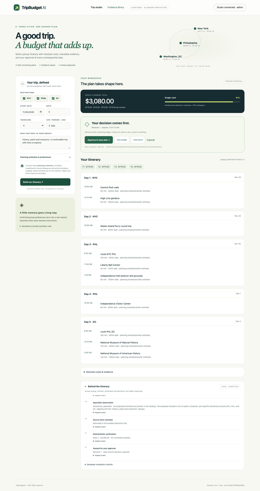
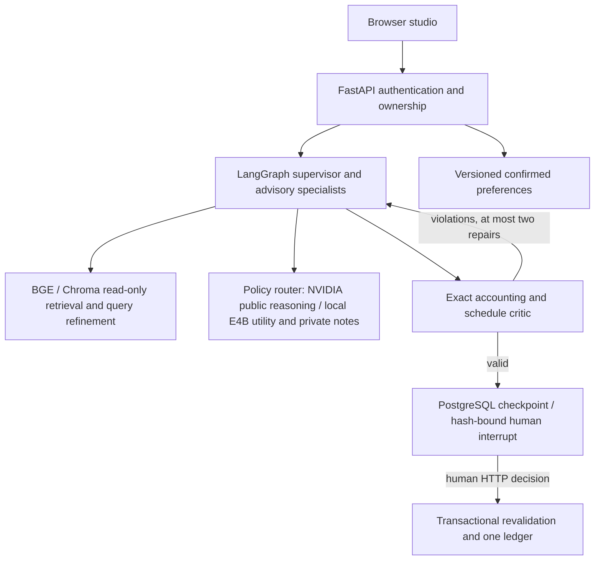

# TripBudgetAI

**New contributor:** start with the [project handoff](HANDOFF.md) for implementation context, access/setup, evidence, limitations and contribution tasks.

An original CSCI599 Assignment 4 capstone by Akshay Mathur: evidence-aware, budget-constrained group travel planning with durable human approval. Built from scratch for this assignment. It does not extend the Assignment 3 assistant.



## What runs

FastAPI serves a browser studio and a LangGraph workflow. A supervisor selects itinerary options; three advisory specialists inspect transit, lodging/meals and attractions. Read-only tools retrieve evidence and construct schedules. Python computes every cost in integer USD cents, critiques constraints and offers bounded validated repairs. Only an authenticated human can approve the exact versioned proposal; a PostgreSQL transaction reconstructs and saves one ledger.

**Five advanced features:** long-term preference memory, planning/self-correction, durable human-in-the-loop approval, iterative RAG/source verification, and hybrid cloud/local inference. Specialists are in-process graph nodes; this project does **not** claim the A2A wire protocol, skill authoring, or self-modifying code. [Video evidence and claim timestamps](docs/recording-evidence.md) show the actual behavior. [Evaluation report](deliverables/EVALUATION_REPORT.md) separates completion, safety and provider failures.

## Scope and assumptions

- NYC, Philadelphia and Washington DC; 3–7 days, 2–6 synthetic adult travelers; tomorrow through 90 days ahead.
- City gateway to city gateway. Flights, home travel, bookings, payments and external messaging are outside the product.
- Three meals/person/day; enough rooms for the declared room capacity; every night except departure day; local transit/person/day; each city transition; activities; a group 10% contingency rounded upward to cents.
- Uniform equal-beneficiary allocation per cost item with largest-remainder cent conservation; unequal individual caps and an optional group cap are enforced separately. This is a shared planning ledger, not a payment splitter or optimizer for personalized subsidies.
- Lodging rates, meal/local/intercity allowances, operating windows, transfers and walking distances are explicit organizer-confirmed **planning estimates**, including taxes/fees. Reviewed official price snapshots are labeled separately. No live availability or accessibility guarantee is made.
- Snapshot manifest records 24 registered official URLs, 68 original summary chunks and 12 activities. Five price facts were reviewed against captured source spans. Other amounts remain estimates; source fetch failures do not become verified facts. See [corpus README](corpus/README.md).
- Privacy scope: raw private synthetic notes use the local model only, are not saved in checkpoints, and cannot supply recipients, budget policy or approval. Structured fields are saved only after explicit confirmation. Ordinary trip prose is public-to-provider input; do not put private information there.

## Quick start (macOS/Linux, Python 3.12, Docker and uv)

```sh
cp .env.example .env
# Edit the database password and add your own NVIDIA and Tavily credentials locally.
# compose.yaml reads TRIPBUDGET_DB_PASSWORD from .env; use the same value in the DSN.
docker compose up -d
uv sync --frozen
uv run python -m scripts.manage migrate
uv run python -m scripts.manage create-user --username organizer --role organizer
uv run python -c 'from tripbudget.retrieval import Corpus; from tripbudget.settings import Settings; Corpus(Settings()).build()'
uv run uvicorn tripbudget.api:app --host 127.0.0.1 --port 8084 --no-access-log
```

Open `http://127.0.0.1:8084`. Your generated account credentials are in `.secrets/organizer.txt` (private, mode 600). Never commit that file. The initial embedding download requires internet; the derived Chroma index can then be rebuilt from versioned original summaries without fetching source pages. `uv.lock` is the dependency authority.

For local inference install Ollama, start a **separate loopback-only** server with `OLLAMA_HOST=127.0.0.1:11435 OLLAMA_MODELS=$PWD/.runtime/models OLLAMA_NO_CLOUD=1 ollama serve`, then in another shell:

```sh
OLLAMA_HOST=127.0.0.1:11435 ollama pull gemma4:e4b
OLLAMA_HOST=127.0.0.1:11435 ollama create tripbudget-gemma4-e4b -f config/ollama.Modelfile
```

The measured release used E4B MLX weights on Apple Silicon and an 8192-token context. Weights are not shipped. Other variants/hardware can change quality and latency; use the same public schema comparison before drawing performance conclusions. Public tasks can fall back to NVIDIA when Ollama is unavailable. Restricted notes always fail closed. Set `TRIPBUDGET_ENABLE_TEST_CONTROLS=true` only on isolated evaluation infrastructure; ordinary organizer accounts cannot enable fault/ablation controls. Evaluation accounts are created with `scripts.manage create-user --role evaluation`.

A source refresh is an explicit operator action: `uv run python -m scripts.build_corpus` then `uv run python -m scripts.review_facts`. Inspect the changes and rebuild Chroma. This changes the evidence version and may invalidate pending approvals. Do not refresh a frozen evaluation mid-run. Expired facts require a new reviewed corpus and a new plan/approval.

## Architecture and topology choice



This uses a standard **Cloud Run service + external PostgreSQL**, a permitted alternative to the handout's named Hermes/OpenClaw deployment path. A bounded HTTP planning workflow benefits from request-scoped execution, resumable checkpoints and scale-to-zero. PostgreSQL is the authority for application state, approvals, counters and official `AsyncPostgresSaver` checkpoints. Ephemeral container disk holds only the reproducible public retrieval index. No background planner is expected to survive container suspension. A disconnected stream cancels its worker; a later explicit run resumes saved state.

The full hybrid demonstration runs locally with the same database-backed application. The deployed Cloud Run release provides cloud public planning and durable approval. It has **no laptop bridge configured**: private notes fail closed, and public utility tasks fall back to cloud. Source supports an explicitly configured HTTP/SOCKS proxy, but no Tailscale security grant was broadened and no cloud-to-laptop hybrid claim is made. See [deployment operations](infra/README.md).

## Guardrails and limits

Strict typed input/output, catalog ID allowlists, integer cents, capacity/night/meal coverage, all-in estimates, source digest/expiry checks, timezone-aware schedules, daily walking bounds and per-person/group caps are checked in code. LLM prose never supplies authoritative prices or approval. Specialists are advisory; rejected IDs are traced and discarded. An unavailable advisory worker is explicitly recorded and does not disable deterministic checks. Unknown supervisor IDs/schema failures still stop planning.

Owner-scoped sessions and endpoints protect episodes, preferences, events and ledgers. Passwords use Argon2; only token hashes persist. Decisions bind a proposal hash, owner, revision and expiry; replay keys have content checks. Database uniqueness and row locks prevent duplicate ledgers. Official checkpoints and application operations share a serialized invocation session; session advisory locks enforce worker ownership and fail with the database connection. Eight connections/store, two executing episodes/process, a maximum of two Cloud Run instances and request concurrency eight bound this demo deployment. Deployment overlap can temporarily double instances; size PostgreSQL connection capacity accordingly (32 app connections at a four-instance overlap, plus operators).

Per episode: at most 24 logical calls, 32 attempts, 160,000 reserved/settled tokens, 20,000 output tokens, four searches, four fetches, 240 active seconds and two repair passes. Provider attempts are at most two, with bounded timeout. Reservations persist before calls; unknown failures keep their conservative allowance. A killed process leaves an active-time marker charged conservatively on recovery. A human pause does not consume active runtime. Daily quotas are persisted (10 organizer episodes and 10 note parses); evaluator quota is separately higher for reproducibility. This is application admission control, not an internet-scale WAF.

Outbound tools expose only read capabilities, registered HTTPS publisher hosts and server-generated public city/topic queries. Redirects/private IPs are denied; there is no email, browser automation, code execution, booking or payment capability in the agent. Residual risks include upstream/provider trust, publisher compromise, DNS time-of-check/time-of-use and prompt influence on advisory prose. These boundaries contain protected state; they do not prove universal injection resistance. See [threat model](docs/THREAT_MODEL.md).

## Test and reproduce

```sh
uv run ruff check src scripts evaluation tests
uv run pytest -q
uv run python -m scripts.audit_witnesses
uv run python -m scripts.browser_check
uv run python -m scripts.verify_package
```

Tests require PostgreSQL and migrated schema. Fast unit/integration tests use explicitly labeled model fixtures; **they are not the adversarial or benchmark evidence**. Evaluation runners use actual providers, Chroma and HTTP/OS behavior. Create `evaluator`, `benchmark`, `adversary`, `operations` and `sources` evaluation users using `scripts.manage`, then:

```sh
uv run python -m evaluation.run_eval --output deliverables/evidence/new-benchmark.jsonl
uv run python -m evaluation.run_attacks --output deliverables/evidence/new-attacks.jsonl
uv run python -m evaluation.compare_models
uv run python -m evaluation.operations
uv run python -m evaluation.live_sources
uv run python -m evaluation.build_report
```

Runners refuse to overwrite evidence; the matched-provider runner resumes only unexecuted `(case,provider,repeat)` keys. Adjust output paths for a new full evaluation. The report names the exact final dataset files. Earlier partial development runs are retained with their actual failures and excluded from final denominators. [Independent oracle](evaluation/oracle.py) checks complete proposals without importing production cost/schedule/validation functions; [witnesses](evaluation/witnesses.json) establish that all twelve feasible inputs have an independently audited plan. Two repeats are a small sample, not a reliability guarantee.

## Submission artifacts

- Source and this Capability-to-Code Map; setup, deployment and evaluation code.
- [Recorded MP4](deliverables/video/TripBudgetAI_Demo.mp4), [feature timestamps](docs/recording-evidence.md) and raw episode evidence.
- [Technical presentation](deliverables/TECHNICAL_PRESENTATION.md) with a saved editable Spaces deck and a portable PDF snapshot.
- [Evaluation report](deliverables/EVALUATION_REPORT.md), raw JSON/JSONL traces and metrics.
- [Individual process-log draft](PROCESS_LOG.md), 200–300 words. Akshay must review the draft and replace its final reflection with his own learning before submitting. No claim of student-authored reflection or Brightspace upload is made.

The GitHub repository is private. Give graders read access or upload the source ZIP/artifacts to Brightspace. The video/source evidence is self-contained; no live application URL is required by the new handout. A local check cannot verify Brightspace submission or access for an unidentified grader.

<!-- CAPABILITY_MAP -->

## Capability-to-Code Map

| Category | Claimed Feature / Guardrail / Eval | Source File(s) & Line Numbers | Key Class / Function | Notes / Scope |
|---|---|---|---|---|
| Advanced Feature 1 | Long-term confirmed preference memory | [src/tripbudget/persistence.py L230–L245](src/tripbudget/persistence.py#L230-L245)<br>[src/tripbudget/graph.py L50–L72](src/tripbudget/graph.py#L50-L72) | `Store.save_preferences`<br>`Workflow.build_graph.load` | Versioned owner/group scope; explicit confirmation; actual process replacement in video |
| Advanced Feature 2 | Planning and self-correction | [src/tripbudget/graph.py L90–L160](src/tripbudget/graph.py#L90-L160)<br>[src/tripbudget/graph.py L211–L238](src/tripbudget/graph.py#L211-L238)<br>[src/tripbudget/planning.py L205–L245](src/tripbudget/planning.py#L205-L245) | `Workflow.build_graph.supervisor`<br>`Workflow.build_graph.assemble`<br>`enumerate_repairs` | Real model choice → deterministic critique → indexed tool-priced repair → recheck; at most two repairs |
| Advanced Feature 3 | Durable human-in-the-loop approval | [src/tripbudget/graph.py L287–L292](src/tripbudget/graph.py#L287-L292)<br>[src/tripbudget/persistence.py L277–L308](src/tripbudget/persistence.py#L277-L308)<br>[src/tripbudget/persistence.py L310–L350](src/tripbudget/persistence.py#L310-L350) | `Workflow.build_graph.approval`<br>`Store.record_decision`<br>`Store.commit_approved` | Official interrupt/checkpoint; owner/hash/revision/expiry; one authorized ledger |
| Advanced Feature 4 | Iterative RAG and source verification | [src/tripbudget/retrieval.py L75–L115](src/tripbudget/retrieval.py#L75-L115)<br>[src/tripbudget/evidence.py L25–L41](src/tripbudget/evidence.py#L25-L41) | `Corpus.retrieve_and_refine`<br>`Catalog.option` | Actual BGE/Chroma refinement; reviewed price snapshots separate from confirmed estimates |
| Advanced Feature 5 | Hybrid cloud/local inference | [src/tripbudget/routing.py L12–L23](src/tripbudget/routing.py#L12-L23)<br>[src/tripbudget/providers.py L32–L189](src/tripbudget/providers.py#L32-L189) | `select_route`<br>`Providers.complete` | Real NVIDIA + E4B local demo; private input cannot fall back externally; no cloud laptop bridge claimed |
| Guardrail 1 | Accounting, schedule and immutable evidence | [src/tripbudget/budget.py L55–L76](src/tripbudget/budget.py#L55-L76)<br>[src/tripbudget/planning.py L194–L202](src/tripbudget/planning.py#L194-L202)<br>[src/tripbudget/schedule.py L20–L62](src/tripbudget/schedule.py#L20-L62) | `financial_violations`<br>`validate_for_commit`<br>`schedule_violations` | Every cap/night/meal/room/transfer; integer cents; commit revalidation |
| Guardrail 2 | Owner and tool/egress permissions | [src/tripbudget/auth.py L37–L61](src/tripbudget/auth.py#L37-L61)<br>[src/tripbudget/outbound.py L27–L42](src/tripbudget/outbound.py#L27-L42)<br>[src/tripbudget/tools.py L11–L13](src/tripbudget/tools.py#L11-L13) | `principal`<br>`validate_url`<br>`authorize_tool` | Read-only capabilities; registered public HTTPS; owner predicates; no mail/shell/booking authority |
| Guardrail 3 | Persisted budgets and worker ownership | [src/tripbudget/resources.py L22–L69](src/tripbudget/resources.py#L22-L69)<br>[src/tripbudget/persistence.py L169–L193](src/tripbudget/persistence.py#L169-L193) | `Budget.reserve`<br>`Store.invocation` | Session-bound advisory lock; call/token/time quotas and conservative unknown usage |
| Adversarial Evals | Ten actual attack types, twice | [evaluation/run_attacks.py L19–L190](evaluation/run_attacks.py#L19-L190) | `main` | 20 attempts; exact model exposure, full real traces and mitigations in report |
| Evaluation Harness | Custom paired tasks, metrics and independent audit | [evaluation/run_eval.py L51–L83](evaluation/run_eval.py#L51-L83)<br>[evaluation/oracle.py L8–L110](evaluation/oracle.py#L8-L110)<br>[evaluation/build_report.py L30–L372](evaluation/build_report.py#L30-L372) | `execute`<br>`audit`<br>`main` | 154 logical evaluation units; fixtures separately labeled; tokens/session and weekly cost |
| Deployment / Persistence | Cloud Run service alternative + external PostgreSQL | [src/tripbudget/persistence.py L138–L142](src/tripbudget/persistence.py#L138-L142)<br>[src/tripbudget/graph.py L49–L363](src/tripbudget/graph.py#L49-L363) | `Store.migrate`<br>`Workflow.build_graph` | Dockerfile; infra/cloudrun.yaml; compose.yaml; official AsyncPostgresSaver; IAM-private deployed smoke |

Deployment configuration: [Dockerfile](Dockerfile), [Cloud Run spec](infra/cloudrun.yaml), [operations and runtime modes](infra/README.md). All five claimed capabilities are tied to actual video segments and raw trace IDs in [recording evidence](docs/recording-evidence.md). Source and artifact SHA-256 inventories are in the release manifest.

<!-- END_CAPABILITY_MAP -->

## Attribution

Application code and original summaries were generated for this capstone with Codex assistance and verified as described in the process log. No Assignment 3 application source was carried forward. Dependencies are imported in code. Standard LangGraph saver/interrupt and MCP client interfaces are library integrations; no tutorial application was copied. Official source URLs and short reviewed spans are recorded in `corpus/catalog.json`; pages are not redistributed wholesale. See [originality and design record](docs/DESIGN.md).
